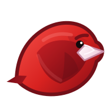
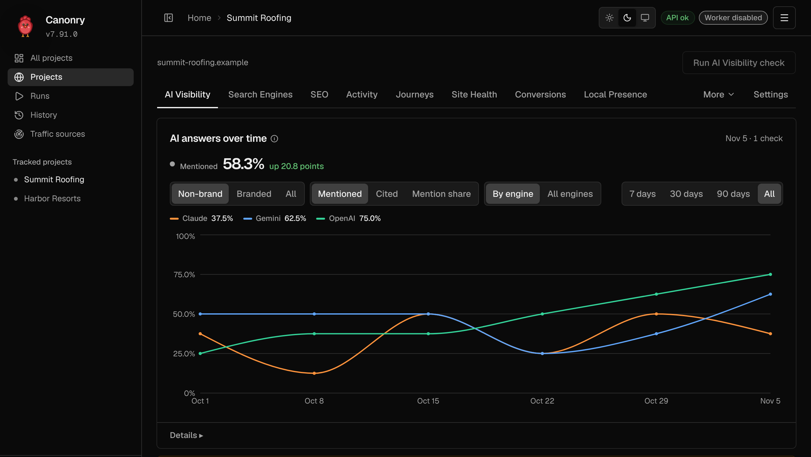
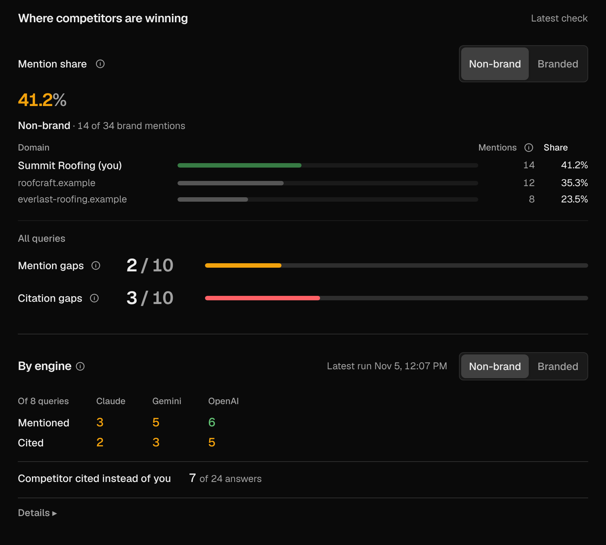
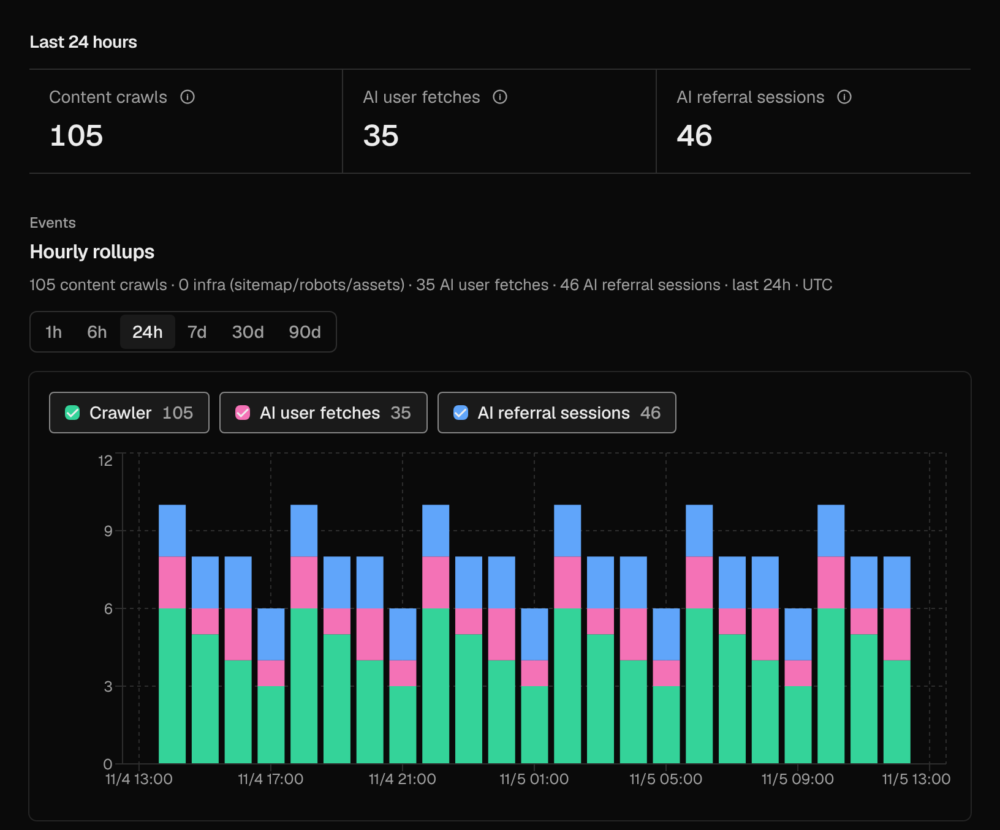
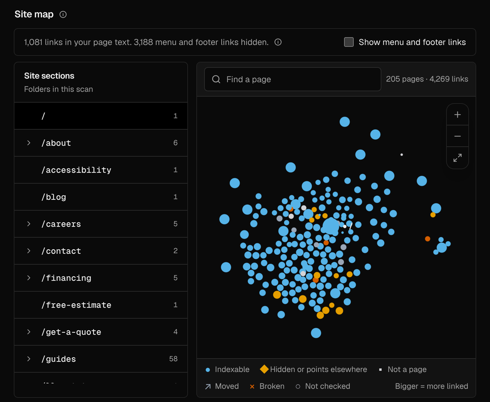
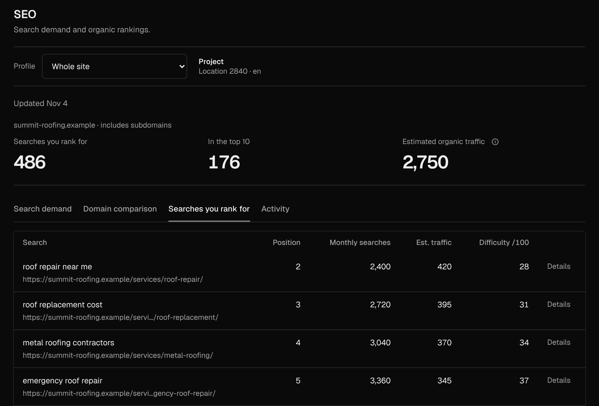
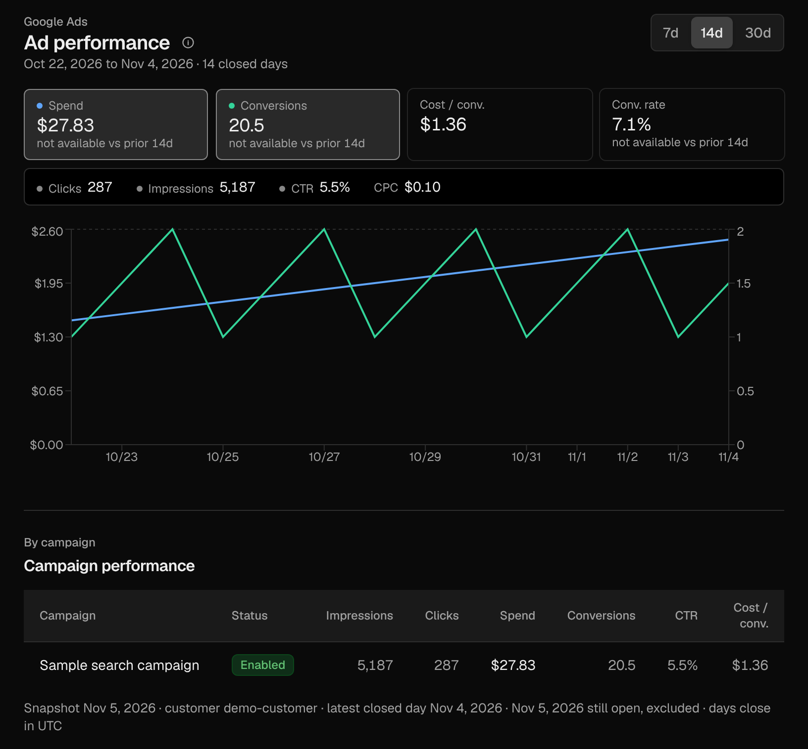
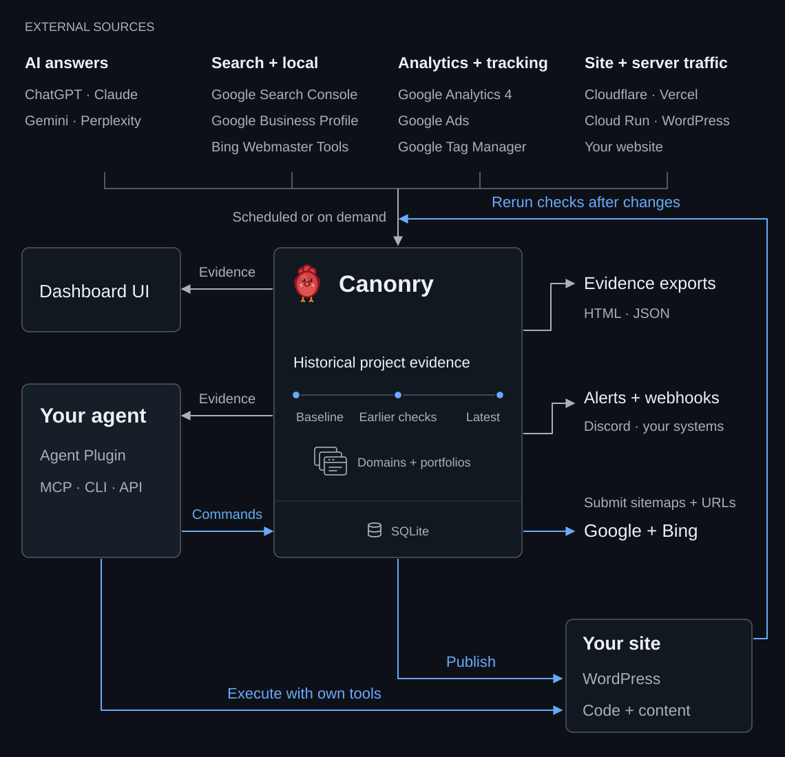

<h1 align="center">
  <a href="https://canonry.ai"></a> Canonry
</h1>

<p align="center">
  <a href="https://www.npmjs.com/package/@canonry/canonry"></a>
  <a href="https://www.npmjs.com/package/@canonry/canonry"></a>
  <a href="./LICENSE"></a>
  <a href="https://discord.gg/8K9yY7GywJ"></a>
  <a href="https://x.com/canonry_ai"></a>
  
</p>

<p align="center">
  <strong>The agent-first AEO operating platform.</strong><br/>
  Track mentions and citations across ChatGPT, Claude, Gemini, Meta Muse, and more. Join them with Search Console, GA4, ads, AI crawler traffic, Agent Readiness site audits, and SEO data. Then let your agent create content, publish fixes, manage ChatGPT ads, get pages indexed, and measure what changed.<br/>
  <sub>Open source · Self-hosted · Bring your own keys</sub>
</p>

<h3 align="center"><a href="https://custom-demo.canonry.ai/projects/summit-roofing"><ins>Try the live demo</ins></a> &nbsp;·&nbsp; <a href="#quick-start"><ins>Quick start</ins></a></h3>

<p align="center">
  <a href="https://custom-demo.canonry.ai/projects/summit-roofing"><picture><source media="(max-width: 600px)" srcset="https://raw.githubusercontent.com/Canonry/canonry/main/docs/images/readme/hero-mobile.png" /></picture></a>
</p>

<a id="explore-the-evidence"></a>
<a id="add-ai-visibility-when-you-need-it"></a>

## Features

### Built for Agents

Everything runs on one REST API. The dashboard, CLI, MCP server, and plugins all call it, so your agent can read and do everything you see.

- **REST API:** every dashboard number has a typed endpoint under `/api/v1`. The full OpenAPI spec is at `GET /api/v1/openapi.json`. [API →](#self-hosting-and-api)
- **CLI:** the same calls as `cnry <command> --format json`, for scripts and shell agents. [CLI →](skills/canonry/references/canonry-cli.md)
- **MCP and plugins:** plugins for Claude Code and Codex, or a hosted MCP server for ChatGPT and Claude Desktop. [MCP →](docs/mcp.md) · [Plugin →](docs/plugins.md)

### AI Visibility

Track brand mentions and citations by query and answer engine. See where competitors win, then open the exact answer and sources behind each result. [Docs →](docs/query-visibility.md)

<a href="https://custom-demo.canonry.ai/projects/summit-roofing"><picture><source media="(max-width: 600px)" srcset="https://raw.githubusercontent.com/Canonry/canonry/main/docs/images/readme/ai-visibility-mobile.png" /></picture></a>

### Server-Side AI Traffic

See what AI agents actually do on your site, from your server logs: which pages GPTBot, ClaudeBot, Meta AI, and Grok crawl, which pages ChatGPT, Claude, and Meta AI open for users, and who clicks through. [Docs →](skills/canonry/references/server-side-traffic.md)

<a href="skills/canonry/references/server-side-traffic.md"><picture><source media="(max-width: 600px)" srcset="https://raw.githubusercontent.com/Canonry/canonry/main/docs/images/readme/traffic-mobile.png" /></picture></a>

<a id="site-health"></a>

### Agent Readiness

A site audit for AI agents. Crawl your site and score how well agents and answer engines can reach, read, and cite each page: AI crawler access, `llms.txt`, structured data, extractable content, and more. Each finding lists the pages it affects, and a map shows the internal links between pages. [Docs →](skills/canonry/references/canonry-cli.md#agent-readiness) · [Audit engine →](https://github.com/Canonry/agent-readiness)

<a href="skills/canonry/references/canonry-cli.md#agent-readiness"><picture><source media="(max-width: 600px)" srcset="https://raw.githubusercontent.com/Canonry/canonry/main/docs/images/readme/site-health-mobile.png" /></picture></a>

<a id="seo-data"></a>

### SEO Research

Keyword volume, difficulty, organic rankings, and search gaps against competitors, powered by DataForSEO Labs. [Docs →](docs/seo-data.md)

<a href="docs/seo-data.md"><picture><source media="(max-width: 600px)" srcset="https://raw.githubusercontent.com/Canonry/canonry/main/docs/images/readme/seo-mobile.png" /></picture></a>

### Ads

Let your agent run ChatGPT Ads: sync campaigns and daily results, create and edit campaigns, and switch them on only after you approve. Track Google Ads spend and conversions, and check each conversion's setup across Google Ads and Tag Manager. Paid results stay separate from organic mentions and citations. [ChatGPT Ads →](skills/canonry/references/canonry-cli.md#openai-ads-chatgpt-ads) · [Google Ads →](docs/google-marketing.md)

<a href="docs/google-marketing.md"><picture><source media="(max-width: 600px)" srcset="https://raw.githubusercontent.com/Canonry/canonry/main/docs/images/readme/ads-mobile.png" /></picture></a>

<a id="compare-competitors-and-measure-complex-portfolios"></a>
<a id="act-on-the-evidence"></a>

**Also in the box:**

- **[Aero](skills/aero/SKILL.md)** — A built-in analyst in the dashboard that reads your evidence and explains what changed.
- **[Portfolios](skills/canonry/references/canonry-cli.md#target-measurement-plans)** — Versioned measurement plans for locations, products, or site sections. Branded and non-brand queries stay separate.
- **[Competitor landscape](docs/competitor-landscape.md)** — Mention share, mentions, and citations for you and your competitors over time.
- **[Query discovery and research](skills/canonry/references/canonry-cli.md#discovery-tracked-basket-expansion)** — Find new queries to track, or run one-off research without changing what you track.
- **[Content engine](skills/canonry/references/canonry-cli.md#content-target-dismissals)** — Finds content gaps and the pages to write or improve next, so your agent can draft them and publish to WordPress for review.
- **[Publish and index](skills/canonry/references/indexing.md)** — WordPress drafts, JSON-LD, and sitemap and URL submissions to Google and Bing.
- **[Schedules and webhooks](skills/canonry/references/canonry-cli.md#scheduling--notifications)** — Rerun checks on a schedule and send alerts to Discord, Slack, or your systems.
- **[Backlinks](skills/canonry/references/canonry-cli.md#backlinks-common-crawl)** — Common Crawl link data, queried locally with DuckDB.
- **[Sentiment](docs/sentiment.md)** — Experimental, off by default. Rates branded answers as favorable, mixed, or unfavorable.
- **And more** — browse the [documentation index](docs/README.md).

**An example job for your connected agent:**

> Find where competitors get cited and we don't. Use search data and the Agent Readiness audit scan to prepare a pull request or WordPress draft for review. After it ships, rerun checks and report what changed.

## How it works

<p align="center">
  <a href="https://raw.githubusercontent.com/Canonry/canonry/main/docs/images/measure-act.svg">
    
  </a>
</p>

---

## Supported Engines

Compare direct AI engines, OpenRouter models, and search answers from Exa and Parallel. Each keeps its own results and history.

<p>
  <a href="https://platform.openai.com/api-keys"><kbd> ChatGPT</kbd></a> &nbsp;
  <a href="https://console.anthropic.com/settings/keys"><kbd> Claude</kbd></a> &nbsp;
  <a href="https://aistudio.google.com/apikey"><kbd> Gemini</kbd></a> &nbsp;
  <a href="https://www.perplexity.ai/settings/api"><kbd> Perplexity</kbd></a> &nbsp;
  <a href="https://dev.meta.ai/"><kbd> Meta (Muse)</kbd></a> &nbsp;
  <a href="docs/providers/openrouter.md"><kbd> OpenRouter</kbd></a> &nbsp;
  <a href="docs/providers/answer-services/exa.md"><kbd> Exa</kbd></a> &nbsp;
  <a href="docs/providers/answer-services/parallel.md"><kbd> Parallel</kbd></a> &nbsp;
  <kbd>+ any OpenAI-compatible local model</kbd>
</p>

**Works with your agent:**

<p>
  <a href="docs/plugins.md#install-for-claude-code"><kbd> Claude Code</kbd></a> &nbsp;
  <a href="docs/plugins.md#install-for-codex"><kbd> Codex</kbd></a> &nbsp;
  <a href="docs/mcp.md"><kbd> ChatGPT</kbd></a> &nbsp;
  <a href="docs/mcp.md"><kbd> Claude Desktop</kbd></a> &nbsp;
  <kbd>+ any MCP client or shell-capable agent</kbd>
</p>

<a id="built-in-integrations-and-workflows"></a>

## Integrations

Connect the sources you use. Each one adds evidence or tools to the same project.

<p>
  <a href="docs/google-search-console-setup.md"><kbd> Search Console</kbd></a> &nbsp;
  <a href="docs/bing-webmaster-setup.md"><kbd> Bing Webmaster Tools</kbd></a> &nbsp;
  <a href="docs/google-analytics-setup.md"><kbd> Google Analytics 4</kbd></a> &nbsp;
  <a href="skills/canonry/references/google-business-profile.md"><kbd> Business Profile</kbd></a> &nbsp;
  <a href="docs/google-marketing.md"><kbd> Google Ads</kbd></a> &nbsp;
  <a href="docs/google-marketing.md"><kbd> Tag Manager</kbd></a> &nbsp;
  <a href="docs/cloudflare-traffic-setup.md"><kbd> Cloudflare</kbd></a> &nbsp;
  <a href="skills/canonry/references/server-side-traffic.md"><kbd> Vercel</kbd></a> &nbsp;
  <a href="skills/canonry/references/server-side-traffic.md"><kbd> Cloud Run</kbd></a> &nbsp;
  <a href="docs/wordpress-setup.md"><kbd> WordPress</kbd></a> &nbsp;
  <a href="docs/seo-data.md"><kbd> DataForSEO</kbd></a> &nbsp;
  <a href="skills/canonry/references/canonry-cli.md#backlinks-common-crawl"><kbd> Common Crawl</kbd></a> &nbsp;
  <a href="skills/canonry/references/canonry-cli.md#openai-ads-chatgpt-ads"><kbd> ChatGPT Ads</kbd></a>
</p>

---

## Quick start

<a id="or-use-any-shell-capable-coding-agent"></a>

### With your agent

Paste this into Claude Code, Codex, or any shell-capable coding agent.

<details>
<summary>Copy the first-time setup request</summary>

```text
Help me set up Canonry for my public site.

Use the official Canonry docs:
- Agent quickstart: https://github.com/Canonry/canonry#or-use-any-shell-capable-coding-agent
- CLI reference: https://github.com/Canonry/canonry/blob/main/skills/canonry/references/canonry-cli.md
- Plugin setup: https://github.com/Canonry/canonry/blob/main/docs/plugins.md
- MCP setup: https://github.com/Canonry/canonry/blob/main/docs/mcp.md

Pick one path and stay on it. Use connected Canonry tools (plugin or MCP) only if you have them and I have not pointed you at a specific install. A connected tool runs in its own process and never sees `CANONRY_CONFIG_DIR`, `CANONRY_PORT`, or anything else you export in a shell, so it always acts on my default install. If I named a config directory, a port, or a sandbox, that is the shell path: use `cnry` and tell me which path you chose. Never mix the two in one run, and never create a duplicate project. The `cnry` and `canonry` commands are interchangeable.

1. Ask for my public domain, country, and language. Do not create or scan anything yet. Country and language are only applied when a project is created, so if you reuse an existing project, report its country and language instead of changing them.
2. Shell path only: confirm `cnry` is on PATH, then run `cnry --version`. If Canonry is missing, propose `npm install -g @canonry/canonry` and wait for approval. Then run `cnry doctor --format json`, which is the command that says whether config, database, and server are in place. `cnry --version` does not read config and succeeds on a completely unconfigured install, so it cannot answer this. If config is missing, run `cnry bootstrap` yourself: it is not interactive, takes about a second, and is safe to rerun. Do not hand it to me and wait. The interactive command is `cnry init`, which is optional provider and OAuth setup that Agent Readiness does not need. Bootstrap prints an API key, so do not repeat its output back to me, and never ask me to paste passwords, API keys, OAuth credentials, or command output.
3. Confirm the API is reachable. `cnry doctor --format json` reports it, and any project read exits non-zero with `CONNECTION_ERROR` when it is not. If it is unreachable, propose `cnry start` and wait for approval. Use `cnry start`, which is the background daemon, and not `cnry serve`, which runs in the foreground and will block you until I stop it, even though some error messages suggest it. Stop anything you started with `cnry stop`.
4. List projects with the connected project tool or `cnry project list --format json`, and reuse one whose domain matches. Confirm the proposed name is not already assigned to a different domain. To find out whether a project has already been scanned, run `cnry agent-readiness score <project> --format json` with no `--run-id`, which reports the latest run. Read the `hasData` field, not the score: this command exits 0 and reports `aggregateScore: 0` for a project that has never been scanned, so reading the score alone would have you tell me my site scored zero. If `hasData` is true and `runStatus` is `completed` or `partial`, read that scan instead of starting a new one. If no project matches, show the exact create operation and wait for approval.
5. Propose a bounded Agent Readiness audit scan: `--max-pages 100` for a first look, plus whether dead-link checking is on (it is off unless you pass `--check-dead-links`). Show the connected operation or the exact `cnry agent-readiness run <project> --max-pages 100 --wait --format json` command with the project name filled in, and wait for separate approval before scanning. `--wait` polls for up to 15 minutes and returns only the run id and status. If the status it returns is still `queued` or `running`, the scan has not finished: do not rerun it or report results, poll `cnry agent-readiness progress <project> --run-id <run-id> --format json` until it is terminal. If `--wait` outruns your own tool timeout first, recover the run id with `cnry runs <project> --kind site-audit --limit 1 --format json`, which returns the newest scan whatever its status, and poll the same way.
6. When the run is `completed` or `partial`, read `cnry agent-readiness overview <project> --run-id <run-id> --format json` first. It is the only one of these commands that carries `termination` and `complete`; the score and page-scores commands do not. Then read `cnry agent-readiness score <project> --run-id <run-id> --format json` and `cnry agent-readiness page-scores <project> --run-id <run-id> --sort score-asc --limit 10 --format jsonl`. Tell me the termination reason in plain words and whether the scan covered the whole site or stopped at a page, link, depth, or time limit. A `partial` run scored the pages it reached and not my site, so never present it as a full-site result. If it stopped early, the fix depends on the reason, so say which: a page or depth limit needs a larger budget, a time limit needs a smaller scan (a lower `--max-pages` or `--max-depth`). If the run failed or was cancelled, inspect the run error and stop.
7. Summarize only completed evidence, then propose AI Visibility setup. Ask before you add queries, connect providers, start a provider-backed or quota-consuming run, edit files, or publish.
```

</details>

### With the plugin

```bash
# Claude Code
claude plugin marketplace add Canonry/canonry
claude plugin install canonry@canonry

# Codex
codex plugin marketplace add Canonry/canonry
codex plugin add canonry@canonry
```

Or connect the [MCP adapter](docs/mcp.md) to any MCP client. Full steps: [Agent Plugin guide](docs/plugins.md).

<a id="get-a-page-health-baseline"></a>

### On your own

```bash
npm install -g @canonry/canonry
cnry bootstrap
cnry serve
```

Then open [http://127.0.0.1:4100/setup](http://127.0.0.1:4100/setup) and follow the setup to scan your site. The crawl saves an Agent Readiness baseline. AI Visibility is optional and has a separate setup.

<details>
<summary>Scan and read results from the terminal</summary>

Keep `cnry serve` active. In a second terminal, create a project and start a bounded scan:

```bash
cnry project create my-site --domain example.com --country US --language en
cnry agent-readiness run my-site --max-pages 100 --wait --format json
```

Read the run ID and status from the output. If the status is `completed` or `partial`, read evidence from that run:

```bash
cnry agent-readiness score my-site --run-id <run-id> --format json
cnry agent-readiness page-scores my-site --run-id <run-id> --sort score-asc --limit 10 --format jsonl
```

`--wait` polls for up to 15 minutes. If the scan remains active, use `cnry agent-readiness progress <project> --run-id <id> --format json`.
If the scan fails or is cancelled, read the error with `cnry run show <run-id> --format json`.

</details>

<details>
<summary>Configure a provider and run visibility checks</summary>

For an existing project, configure a provider with your own key.

| Provider | Key source | Environment variable |
|---|---|---|
| Gemini | [Google AI Studio](https://aistudio.google.com/apikey) | `GEMINI_API_KEY` |
| OpenAI | [OpenAI Platform](https://platform.openai.com/api-keys) | `OPENAI_API_KEY` |
| Meta (Muse) | [Meta Model API](https://dev.meta.ai/) | `MUSE_API_KEY` |
| Claude | [Anthropic Console](https://console.anthropic.com/settings/keys) | `ANTHROPIC_API_KEY` |
| Perplexity | [Perplexity settings](https://www.perplexity.ai/settings/api) | `PERPLEXITY_API_KEY` |
| [OpenRouter](docs/providers/openrouter.md) | [OpenRouter keys](https://openrouter.ai/keys) | `OPENROUTER_API_KEY` |
| [Exa](docs/providers/answer-services/exa.md) | [Exa dashboard](https://dashboard.exa.ai/api-keys) | `EXA_API_KEY` |
| [Parallel](docs/providers/answer-services/parallel.md) | [Parallel platform](https://platform.parallel.ai) | `PARALLEL_API_KEY` |
| Local model | Any OpenAI-compatible endpoint | `LOCAL_BASE_URL` |

Add the queries that matter to your project:

```bash
cnry query add my-site "your first query" "your second query"
cnry run my-site --wait
cnry visibility-stats my-site --by-provider
```

</details>

<a id="why-we-use-model-providers-apis-directly-not-a-router"></a>

<details>
<summary>Direct APIs, OpenRouter, and search answer services</summary>

Canonry supports direct model APIs, OpenRouter, and search answer services such
as Exa and Parallel. Direct adapters retain the search and grounding details
each provider exposes. OpenRouter offers multiple models through one key. Exa
and Parallel search the web and return answers with source evidence.

Each direct engine, OpenRouter model route, and service profile keeps separate
results and history. The same model through different APIs can return different
answers and citation evidence. Canonry measures brand mentions separately from
source citations and keeps missing evidence unknown.

[Provider guides](docs/providers/README.md) describe the evidence and limits of
each integration.

</details>

<details>
<summary>Discover questions or run one-off research</summary>

**Expand your tracked questions.** Run `cnry discover run <project> --icp "..."`. This does not change the tracked questions.
Preview a completed session with `cnry discover promote preview <project> <session-id>`. Promote only after approval.

**Research without changing tracking.** Run `cnry research run <project> "query one" "query two" --wait`.
For a configured portfolio destination, select one `--market <key>` or `--property <key>`; Canonry saves the destination with the answers without changing the query. Add paired `--template-id <id> --template-version <version>` only to preserve an already-expanded template's provenance. Research never adds queries to the tracked questions.

</details>

<a id="if-you-get-stuck"></a>

<details>
<summary>Troubleshoot installation, scans, and visibility results</summary>

| Problem | Next step |
|---|---|
| Agent Readiness audit scan is still active | Read exact counters with `cnry agent-readiness progress <project> --run-id <id> --format json`. |
| Agent Readiness audit scan failed | Read the error with `cnry run show <run-id> --format json`. Read the last phase and counters with the progress command. |
| No visibility results | Inspect existing work with `cnry runs <project> --format json`, then `cnry run show <run-id> --format json`. This does not start another paid run. |
| `npm install` fails on `node-gyp` | Install build tools for `better-sqlite3` ([guide](https://github.com/WiseLibs/better-sqlite3/blob/master/docs/troubleshooting.md)). |

</details>

<a id="deployment-and-trust-boundary"></a>
<a id="technical-surface"></a>

## Self-hosting and API

Canonry is single-tenant. Run one instance for one operator or team. Keep unrelated teams on separate instances.

The CLI and REST API are the primary interfaces. They expose measurements, diagnoses, actions, evidence exports, and schedules.
OpenAPI is available at `GET /api/v1/openapi.json`.

See the [deployment guide](docs/deployment.md) for reverse proxies, daemon mode, Docker, systemd, and Tailscale.

## Documentation

- **Operate Canonry:** [CLI reference](skills/canonry/references/canonry-cli.md) · [Agent Plugin](docs/plugins.md) · [MCP](docs/mcp.md)
- **Use built-in Aero:** [Setup and analysis workflows](skills/aero/SKILL.md)
- **Understand the system:** [Architecture](docs/architecture.md) · [Data model](docs/data-model.md)
- **Install standalone agent skills:** `cnry skills install` ([guide](skills/canonry/SKILL.md))
- **Browse all guides:** [Documentation index](docs/README.md)

---

<a id="support"></a>

## Community &amp; Support

- **Discord:** Join the community on **[Discord](https://discord.gg/8K9yY7GywJ)** for help and questions.
- **Twitter / X:** Follow **[@canonry_ai](https://x.com/canonry_ai)** for updates.
- **Feedback &amp; Ideas:** Missing something? [Open an issue](https://github.com/Canonry/canonry/issues).
- **Show Support:** [Star](https://github.com/Canonry/canonry) this repo to follow along.

---

## Contributing

```bash
git clone https://github.com/Canonry/canonry.git && cd canonry
pnpm install
```

For local agent work, run tests only after changes are finalized and ready for push or review.
`pnpm verify` is optional locally. See [CONTRIBUTING.md](./CONTRIBUTING.md) and the [testing guide](docs/testing.md).

<a href="https://github.com/Canonry/canonry/graphs/contributors">
  
</a>

## License

[MIT](./LICENSE), starting with Canonry 5.0.0. Use, modify, self-host, redistribute, and build commercial products with Canonry. Keep the copyright and permission notice with copies or substantial portions of the software.

Earlier releases retain their original licenses, including any future-license grants. Dependencies and bundled assets retain their own licenses; see [third-party notices](packages/canonry/THIRD_PARTY_NOTICES.md).
