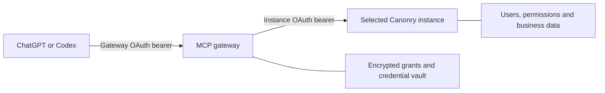

# Canonry MCP gateway

The gateway is configured for one public MCP address, `https://mcp.canonry.ai/mcp`.
This source and hostname do not establish a live deployment.
During authorization the user enters a workspace slug or registered domain,
then signs in through
that instance's existing Canonry login and consents to read access. One grant
belongs to one instance and its immutable local user ID. It cannot switch
workspaces through MCP arguments or combine multiple instances.



The independently deployed app forwards the complete supported read-only
catalog. Canonry remains the owner of business tools, resources, prompts and
permissions. Simple and Advanced Measurement use the same connection. The
synthetic reviewer instance uses exactly the same transport and catalog policy.

`canonry_gateway_profile` is the one gateway-owned authentication wrapper. It
returns a persisted opaque profile ID plus available display labels from the
current authorized connection. It adds no business operation and accepts no
workspace/user override. IDs survive refresh, reconnection and display changes;
the same local user ID on two instances remains two different profiles. Every
tool descriptor declares the gateway's `read` OAuth scope at top level and in
`_meta`. These declarations supplement server-enforced authorization. See the
[OpenAI profile/authentication contract](https://developers.openai.com/plugins/build/auth).

See the [engine contract](../../docs/mcp-gateway-contract.md) for discovery,
profile identity, refresh/revocation and session behavior. The canonical upstream
OAuth resource ends in `/api/v1/mcp`; the transport ends in
`/api/v1/mcp/readonly`. They are deliberately different. Read discovery and verify
it against the registry before using either endpoint.

Every upstream must implement that hardened engine contract, including durable
grant lineage, refresh replay protection, grant-wide revocation and current user
authority. Legacy compatibility describes the MCP wire protocol only; it does
not permit an older engine that lacks those controls. Operators must validate
these behaviors before onboarding. Protocol negotiation and the catalog policy
label do not attest to engine hardening.

## Configure

Environment parsing lives in `packages/config/src/mcp-gateway.ts`. Configuration
errors stop startup. The gateway never reads `~/.canonry/config.yaml`.

| Setting | Provisioning |
| --- | --- |
| `CANONRY_GATEWAY_CONFIG` | Absolute path to the operator-managed JSON registry. Mount read-only. |
| `CANONRY_GATEWAY_VAULT_KEY` | Secret manager value: canonical base64 encoding of 32 random bytes. Keep separate from the database and backups. |
| `CANONRY_GATEWAY_COOKIE_KEYS` | Secret manager value: JSON array of random signing keys, each at least 32 characters. Current key first; retain old keys during rotation. |

The JSON configuration contains:

| Field | Required production value |
| --- | --- |
| `issuer` | Exact public HTTPS origin, without trailing slash; production uses `https://mcp.canonry.ai`. |
| `development` | `false`. Loopback HTTP is allowed only when explicitly `true`. |
| `host`, `port` | Bind `0.0.0.0` in the container, port `4101`; restrict ingress to the TLS proxy. |
| `databasePath` | Persistent path such as `/data/gateway.sqlite`; never `:memory:`. |
| `clients` | Approved public OAuth clients and exact redirect URIs (portless loopback URIs for `native` clients). |
| `tenants` | Approved workspace registrations described below. |
| `requestTimeoutMs` | Bounded upstream request timeout; default 30000. |
| `rateLimitPerMinute` | Request budget; default 120. |
| `maxBodyBytes` | Maximum request body size; default 1048576. |
| `trustedProxyAddresses` | Exact proxy peer IPs allowed to supply a single `X-Forwarded-For` client address for rate limiting. Default empty. |
| `domainVerificationToken` | Optional exact portal challenge token. It is returned as plain text at `/.well-known/openai-apps-challenge`. |

The remote plugin uses `client_id: canonry-chatgpt` with
`token_endpoint_auth_method: none`, `grant_types: [authorization_code,
refresh_token]`, and `response_types: [code]`. Copy the exact callback URI from
its connection setup into `redirect_uris`. Give each other client its own ID and
registered redirect list. Do not guess callback paths, accept wildcard
redirects, or add a client secret to the plugin package.

A CLI or desktop client that receives the code on a loopback port it picks for
each sign-in, such as Claude Code, sets `application_type: "native"` and
registers loopback HTTP redirects without a port, for example
`http://localhost/callback`. The gateway then accepts any port on that exact
host and path (RFC 8252 section 7.3); the host must match, so register
`localhost` and `127.0.0.1` separately when a client can use either. Every other
client stays `web` (the default) with exact HTTPS redirects. The Claude Code
adapter in `plugins/canonry-remote` uses the first entry below. Claude Code calls
back on `localhost`; versions 2.1.229 and 2.1.230 used `127.0.0.1`, and Claude's
published client metadata lists both. Claude on the web, desktop and mobile
calls back on one HTTPS URI and accepts a user-entered client ID, so it uses the
second entry:

```json
{ "client_id": "canonry-claude-code", "client_name": "Claude Code", "application_type": "native", "redirect_uris": ["http://localhost/callback", "http://127.0.0.1/callback"] }
{ "client_id": "canonry-claude", "client_name": "Claude", "redirect_uris": ["https://claude.ai/api/mcp/auth_callback"] }
```

Each tenant entry supplies an immutable `id`, `displayName`, approved `origin`,
`issuer`, canonical `resource`, read-only `mcpUrl`, `enabled`, compatible
`protocolVersions`, `catalogVersion: "canonry-readonly-v1"`, and the instance's pre-registered
`upstreamClientId`. Register the gateway's exact `${issuer}/upstream/callback` URI at that instance
before onboarding (production: `https://mcp.canonry.ai/upstream/callback`). Use discovered endpoints and the engine's supported versions. The gateway
negotiates a supported MCP version and enforces the read-only annotation policy.
`catalogVersion` selects that gateway policy contract; it is not a version
attested by the upstream profile or initialization response.
Never derive a destination from an email address, tool input or incoming header.

The public consent page does not list workspace names, IDs or origins. The
workspace field accepts an exact registry ID or registered host, including a
port in development. Unknown, ambiguous and unavailable entries show the same
retry message. The submitted value only selects a registry entry. It never
becomes a network destination. A separate handoff page starts upstream login
after selection, so the initial CSP does not expose tenant origins.

Private upstream origins require an operator's explicit `allowPrivateNetwork`
provision. This permits an approved deployment topology, not arbitrary user URL
fetching. Review network egress policy for each approved origin. Never recycle a
tenant ID for a different instance or move an existing grant to a new origin.

## Build and run

From the repository root, on a supported Node version:

```sh
pnpm install --frozen-lockfile
pnpm --filter @canonry/canonry-mcp-gateway build
pnpm --filter @canonry/canonry-mcp-gateway start
```

Provision the three environment settings before `start`. Keep configuration and
secret files outside the source tree. Do not use an existing customer instance
for local testing.

Build the standalone image from the repository root:

```sh
docker build -f apps/mcp-gateway/Dockerfile -t canonry-mcp-gateway:review .
```

Run one active replica with a persistent `/data` volume owned by UID 1000,
a read-only configuration mount and secret-manager-injected environment values.
Use a read-only container filesystem except `/data` and a bounded temporary
filesystem. Expose only the TLS proxy. The Dockerfile pins Node 24.22.1 LTS, supported by the OAuth library, and installs
the frozen dependency graph.

Terminate HTTPS at a trusted proxy configured for the exact public hostname.
Strip untrusted forwarding headers; preserve the approved public origin. Allow
MCP POST/GET/DELETE and streaming response bodies, disable buffering for SSE,
and set proxy timeouts above the application request timeout. Apply connection,
request-size and anonymous-auth rate limits at ingress as well as in the app.
`GET /health` is a liveness probe; successful liveness does not prove every tenant
is reachable or its user credentials remain valid.

## Request capacity and reuse

Each authenticated MCP HTTP request checks current instance authority once. Long-lived notification
streams check authority again before delivery. Each tool call still checks the
read-only catalog, and the instance enforces its current permissions.

The gateway reuses HTTP connections within one tenant, origin and network policy.
Every new socket still uses the validated DNS lookup. Modern requests exclusively
lease upstream MCP clients. Reuse stops after 60 idle seconds or five minutes
since client creation.
Catalog verification lasts at most five seconds per upstream client. Grant,
user, bearer, effective profile scope and registry policy changes prevent reuse.
Catalog-change notifications invalidate verification immediately. A failed
catalog refresh cannot use an expired result.

Admission includes clients that are opening, active or idle. Limits are 16 per
grant, 32 per tenant/user and 1,000 across the gateway. Idle reusable clients can
be evicted. When capacity is unavailable, the gateway returns 503. Legacy sessions
expire after ten idle minutes. These limits prevent one grant from occupying
the shared pool, but they do not replace ingress limits.

## Operational procedures

- **Suspend a workspace:** set its registry entry `enabled: false`, then restart
  the single gateway replica to load the edited registry. Verify a previously
  authorized connection is denied. Do not delete or reuse the tenant ID.
- **Disconnect:** send `POST /disconnect` with the gateway bearer to invalidate
  the outer grant and its MCP sessions immediately, then attempt upstream
  grant revocation. Failed upstream revocation remains queued durably for retry;
  it does not restore local access.
  OAuth clients may instead use the discovered `/oauth/revoke` endpoint; upstream
  cleanup then follows the gateway's grant cleanup lifecycle. Verify old access
  and refresh credentials are rejected. Reconnecting requires fresh instance
  authorization.
- **Refresh:** serialize refresh requests for each grant. Store each replacement
  refresh token before another refresh. A lost response can require authorization
  again. Consumed-token replay revokes that grant and its descendants, including
  concurrent duplicate refreshes. There is no grace window for public bearer
  clients: the gateway cannot distinguish a retry from a stolen token. This
  preserves the replay response in
  [RFC 9700 section 4.14.2](https://www.rfc-editor.org/rfc/rfc9700.html#section-4.14.2).
- **Failed authorization:** credentials issued before profile/setup failure remain
  encrypted until upstream revocation succeeds. Pending cleanup survives restart
  and retains the original registered upstream client.
- **User or role changes:** make the change in the owning Canonry instance.
  Subsequent gateway requests must check current instance authority. A gateway
  session ID must not preserve deleted-user or revoked-grant access.
- **Upstream outage:** keep the error distinct from empty evidence. Do not route
  to another workspace, substitute demo data, or start provider work. Legacy
  upstream sessions require reinitialization after bearer refresh or session loss.
  Modern requests use the current bearer without a session recovery step.
- **Back up:** take a consistent SQLite backup with its WAL state, encrypted
  at rest, and keep the encryption key recoverable through the secret manager.
  Copying only the live main database file can lose committed WAL writes.
- **Cookie key rotation:** add a new key first while retaining previous keys for
  the maximum session lifetime, then remove old keys after that interval.
- **Vault key rotation:** there is no online re-encryption command. Do not simply
  replace the key against an existing database. Use a planned reconnect/reset
  procedure or implement and validate offline re-encryption first.
- **Monitor:** collect health, request counts, latency, rate-limit and upstream
  error categories. Request and background error events contain fixed error
  classes/codes and registered tenant IDs when known. Unexpected failures return
  500. Malformed upstream metadata, tokens or profiles return 502. Client JSON
  errors remain 400. Logs must not include bearer tokens, cookies, OAuth codes,
  verifiers, tool arguments, response bodies or full callback URLs.

Deploy with a stop/start replacement, not overlapping replicas sharing SQLite.
Before an upgrade, retain the previous image, registry, secrets and a consistent
backup. Validate the new version with disposable fixtures and staging first. To
roll back, stop the new version and restore the previous compatible image and
state together. Never restore stale refresh-token state after the upstream has
rotated it; disconnect affected grants and reconnect instead. A rollback must
not resurrect revoked grants. Production deployment and DNS changes require a
separate release action.

## Local validation

The gateway suite must start two actual Canonry instances from the shared
synthetic fixture, each with a separate temporary DB, users, projects and tokens.
It must not read existing local configuration or call paid providers. Run final
checks only after implementation is ready for review:

```sh
pnpm check
pnpm --filter @canonry/canonry-config typecheck
pnpm --filter @canonry/canonry-config lint
pnpm --filter @canonry/canonry-config test
pnpm --filter @canonry/canonry-mcp-gateway typecheck
pnpm --filter @canonry/canonry-mcp-gateway lint
pnpm --filter @canonry/canonry-mcp-gateway test
pnpm --filter @canonry/canonry-mcp-gateway build
pnpm plugin:check
```

Integration evidence must distinguish successful OAuth and consent, audience
checks, persistent profile identity across refresh/reconnection/display changes,
full upstream catalog/resource/prompt parity plus the identity-only wrapper, representative data reads, rejected
writes, tenant/session isolation, invalid transactions, refresh/replay, disconnect,
user/role changes, suspension, outage and restart recovery. Check actual results;
a list of declared tools or passing mocked upstream tests is insufficient.
Record each validation result with its tested revision and command. Keep these
evidence categories separate:

| Check | What it establishes |
| --- | --- |
| Real-engine local integration | Gateway behavior against isolated synthetic Canonry instances at the tested revisions. |
| Container build and smoke | The image builds and starts with the tested mounts/configuration. It does not establish public reachability or host compatibility. |
| Live ChatGPT/Codex walkthrough | Actual host import, OAuth, tool use and reviewer access against the deployed endpoint. This remains unrun until separately recorded. |

Network stubs cover network boundaries only. Neither local integration nor a
container smoke substitutes for the live host walkthrough.

## Validation recorded on 2026-10-28

After the review fixes, the Node 24.22.1 gateway suite passed **79/79 tests**,
with no failures or skips. Shared config passed **38/38** on the unchanged
configuration source, reused from commit `2062e1d2377c1598a38cea834bc388ed777bc63e`. Two actual isolated engines cover Simple
and Advanced portfolios, modern/legacy combinations, exact catalog and result
parity, scoped identity, refresh, revocation, outages and restarts. SDK protocol
fixtures additionally exercise streaming, cancellation, empty cursors and
subscription/logging recovery. Pre-fix runs detected the repaired lifecycle,
protocol and browser-header regressions. Review fault probes also reproduced
workspace-origin disclosure, extra sockets/profile reads, repeated SDK setup,
missing admission limits, stale concurrent catalog validation, silent failures,
incorrect 400 responses and an uncaught malformed-status error. All source was
restored before the final 79-test passing run.

The engine base is [PR #1427](https://github.com/Canonry/canonry/pull/1427), commit
`15c101a557e0371cbb1c4a58e8673f2316b118f5`. Its unchanged engine validation is
recorded there. The combined 7.74.0 tarball was built, installed outside the
checkout, and smoke-tested across REST, CLI, modern and legacy HTTP/stdio MCP,
including Simple/Advanced evidence and permission denials with loopback stubs.

Chrome checks passed at 1440×900, 390×844 and 320×720: readable content without
horizontal overflow; keyboard order Workspace, Connection details, Approve,
Cancel. Cancel returns
`access_denied` with the original state; Approve reaches the provisioned
synthetic login. All destinations were loopback fixtures. See the
[desktop](docs/consent-desktop.png), [mobile](docs/consent-mobile.png),
[before styling](docs/consent-unstyled.png), and
[pre-fix failure](docs/consent-before.png) captures. These checks do not establish
live ChatGPT/Codex compatibility or production deployment.

The consent screen follows Canonry's dark Geist palette, typography and canary
branding. Native controls keep the page usable without JavaScript; narrow screens
use full-width actions and at least 44px touch targets. Connection details expand
in place, including long callback addresses. The workspace field remains blank
until the user enters a slug or domain.
Cancel works with an empty field. Fonts are served locally, with their
license included in the container. A fresh nonce authorizes only the page's
styles; no external assets or inline scripts are permitted. Browser checks
confirmed loaded fonts, visible keyboard focus and wrapped long client labels
and callback addresses.
Security tests cover escaped configuration values, nonce rotation, empty-field
cancellation and the fixed font route.

Final typechecks, type-aware lint, `pnpm check`, generated SDK/guidance/Val
checks, plugin drift checks and builds passed. Config lint retains one existing
warning in `src/index.ts:448`. The standalone Docker image also passed health,
OAuth discovery, unauthenticated MCP challenge, non-root/read-only filesystem,
signing-identity persistence across container restart, and packaged consent,
SVG, font GET/HEAD and font-license checks.

## Reviewer walkthrough

The package and eight review cases are in
[`plugins/canonry-remote`](../../plugins/canonry-remote/README.md). Their current
status is **not run in ChatGPT/Codex**. Local integration results do not establish
that a reachable deployed endpoint works in either host.

1. Deploy a dedicated synthetic Canonry instance with the hardened engine
   version. Seed Simple and Advanced Measurement projects, distinct mentioned
   and cited evidence, branded/non-brand queries, Property/Target/market scope,
   and missing-data cases. Disable paid providers and automatic paid work.
2. Create a dedicated ordinary reviewer account through the instance's existing
   supported login. Make that login usable without access to an operator's
   personal inbox, phone, network or social account. Store its credentials and
   exact login/workspace instructions only in the portal's secure access fields.
3. Register this instance through the normal gateway registry. Do not special-case
   its client, tools or authorization. Verify both positive reads and prohibited
   operations through the same endpoint customers will use.
4. In a development ChatGPT/Codex connection, authenticate through the gateway,
   enter the synthetic workspace slug, sign in and approve read-only access. Run the
   five positive and three negative prompts from `plugin.json`. Save each actual
   tool call, its result and the user-visible response as Passed, Failed, Blocked
   or Not run in private review evidence. Never include credentials in captures.
5. Record the real flow: workspace selection/consent; project listing; distinct
   mention/citation evidence; Advanced Property ranking and answer evidence; and
   a denied write/research request. Show results long enough to read. Stop before
   displaying secrets. A script or screenshot is not a completed recording.
6. Play back the recording, verify host/version and scope, and host it at a
   reviewer-accessible URL. Only then populate `review.demo_recording_url`.
7. Resolve listing/publisher/policy gaps, prepare the upload archive, and complete
   domain verification and a current scan in the portal after upload is authorized.
   Serve the portal's exact token; do not overwrite a token used by another plugin
   at the same challenge URL. Inspect tool annotation/security findings against
   the actual complete read-only catalog.

Do not claim live validation, reviewer access, submitted status or publication
until that specific action has succeeded. Keep demo accounts and data maintained
for subsequent review; changes to a customer's account never affect demo access.
