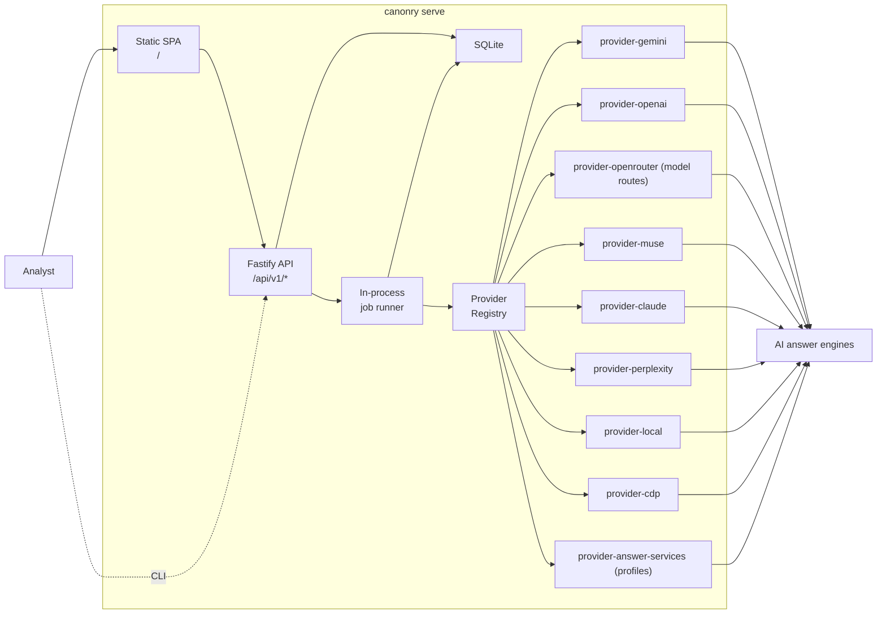
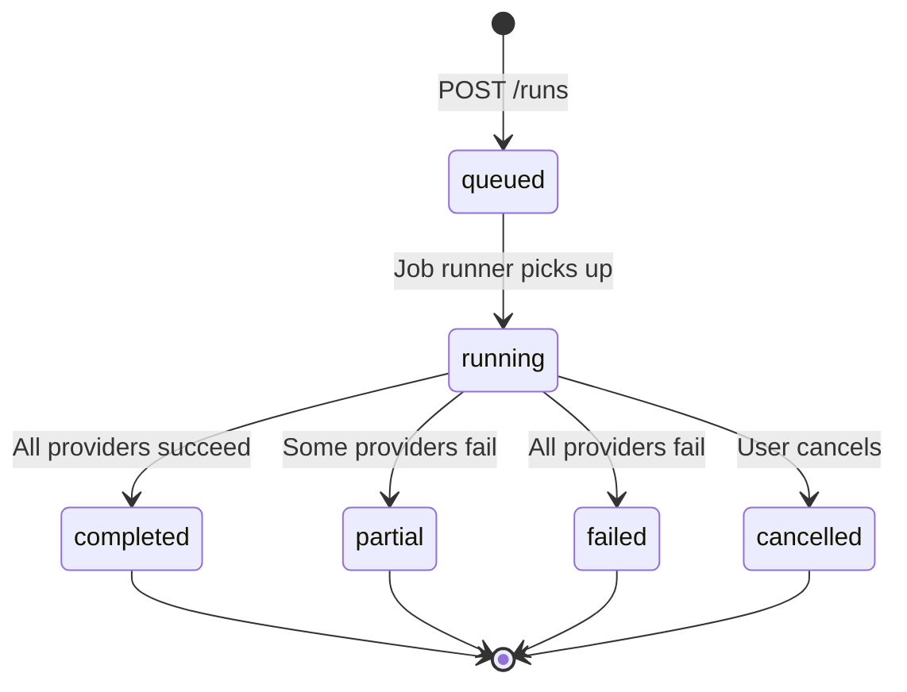

# Architecture

## Overview

Canonry is a self-hosted, agent-first AEO platform. It measures brand mentions and domain citations for tracked queries across its [supported providers](providers/README.md). Its content engine and integrations use those observations. The Local adapter captures no structured sources, so its answers contribute to mention measurements only.

A project can define named locations and a default location. An Advanced Measurement plan also assigns queries and measurement contexts to Properties and markets.

## Local Architecture

The local installation runs as a **single Node.js process** with SQLite and an in-process job runner.

### Key components

- **`packages/canonry/`** — publishable npm package (`@canonry/canonry`). Bundles CLI, Fastify server, job runner, and pre-built SPA.
- **`packages/api-routes/`** — shared Fastify route plugins. The HTTP surface consumed by the local `cnry serve` process.
- **`packages/db/`** — Drizzle ORM schema, backed by SQLite. Auto-migration on startup.
- **`packages/provider-*/`** — Provider adapters. Each implements `ProviderAdapter` from contracts.
- **`packages/contracts/`** — shared DTOs, enums, config-schema (Zod), error codes.
- **`apps/web/`** — Vite SPA source. Built and bundled into `packages/canonry/assets/`.

### Data flow

1. Analyst runs `canonry run <project>` with the project default location, an explicit `--location`, `--all-locations`, or no location context
2. API creates a run record and enqueues a job
3. The job runner executes the run's selected providers and queries. A published plan supplies frozen execution slots. Each adapter receives the requested location and reports its treatment.
4. Each saved answer records its mention and citation observations by query and provider. Plan-aware runs also record the execution ID and location context.
5. Transitions (`lost`, `emerging`) are computed at query time by comparing each measured snapshot with the last measured one before it. A `not-measured` snapshot is skipped, so it never gains or loses a citation
6. Dashboard polls API for results and renders visibility data

## Module Dependency Graph

```mermaid
flowchart TD
  subgraph Apps
    web["apps/web"]
    api["apps/api"]
  end

  subgraph Packages
    canonry["packages/canonry"]
    routes["packages/api-routes"]
    contracts["packages/contracts"]
    db["packages/db"]
    config["packages/config"]
    intelligence["packages/intelligence"]
  end

  subgraph Providers
    gemini["provider-gemini"]
    openai["provider-openai"]
    openrouter["provider-openrouter"]
    muse["provider-muse"]
    claude["provider-claude"]
    local["provider-local"]
    perplexity["provider-perplexity"]
    cdp["provider-cdp"]
    answerServices["provider-answer-services"]
  end

  subgraph Integrations
    gsc["integration-google"]
    ga4["integration-google-analytics"]
    bing["integration-bing"]
    wp["integration-wordpress"]
  end

  web -.-> contracts
  api --> routes & db & config & contracts

  canonry --> routes
  canonry --> db
  canonry --> config
  canonry --> contracts
  canonry --> intelligence
  canonry --> gemini & openai & openrouter & muse & claude & local & perplexity & cdp & answerServices

  routes --> db
  routes --> contracts
  routes --> gsc & ga4 & bing & wp

  gemini & openai & openrouter & muse & claude & local & perplexity & cdp & answerServices --> contracts
  gsc & ga4 & bing & wp --> contracts
  db --> contracts
```

**Key rules:**
- `packages/api-routes/` must not import from `apps/*`.
- Only `packages/canonry/` is published to npm. All other packages are bundled via tsup.
- All internal packages use `@canonry/canonry-*` naming convention.

## Run Lifecycle

**Transitions:**
- `queued` → `running`: Job runner dequeues and starts executing providers
- `running` → `completed`: The sweep finished with all planned answers
- `running` → `partial`: The sweep saved answers and recorded provider errors, skipped providers, or a plan shortfall
- `running` → `failed`: The sweep saved no answers and recorded a failure
- `running` → `cancelled`: User explicitly cancelled via API

## Provider System

The shared [`ProviderAdapter` interface](../packages/contracts/src/provider.ts)
defines execution, normalization, and optional capabilities such as batch
dispatch and text generation. The provider registry registers configured
connections. OpenRouter model routes and search answer service profiles use
their connection's credentials and quota. Each route requires explicit selection.

The job runner executes the selected work and normalizes responses before it
persists them in `query_snapshots`. Plan-aware runs can store several answers
for one query and provider when the execution contexts differ.

Ad-hoc research uses the same provider adapters through a separate
`research_runs` → `research_run_queries` executor. It persists returned answer
evidence and applies the same provider quota guards, but it never creates a
tracked query, shared run, snapshot, insight, notification, or schedule event.

## Deployment Model

Run `canonry serve` on your own machine, a VPS, or a container. One process serves the SPA and REST API, runs jobs and schedules, and uses SQLite. See the [deployment guide](deployment.md) for setup.

The standalone `apps/api` entry point mounts the shared REST routes on Cloud Run and uses SQLite. The full engine runs through `canonry serve`.

## Service Boundaries

- **`@canonry/agent-readiness`** (formerly `@canonry/aeo-audit`) — published
  audit engine used by the local `packages/canonry` Agent Readiness executor. It
  provides the full-site crawl event and graph contract.
- **`apps/api/`** — standalone Cloud Run REST entry point.
- **`packages/api-routes/`** — HTTP surface, validation, orchestration, read APIs.
- **`packages/canonry/`** — CLI, local server, job runner (the publishable artifact).
- **`packages/provider-*/`** — Provider adapters and normalization layers.
- **`packages/integration-*/`** — External service clients (Google, Bing, GA4, WordPress).
- **`packages/db/`** — schema, migrations, database access.
- **`packages/contracts/`** — DTOs, enums, config validation, error codes.
- **`packages/config/`** — typed environment parsing.
- **`apps/web/`** — SPA source code.

## Design Constraints

- This repo remains independent from the audit package repo
- Consume only published audit-engine releases; keep the local
  `@canonry/agent-readiness` pin explicit
- REST API keys, signed-in browser sessions, and OAuth for hosted MCP
- Raw observation snapshots only; transitions computed at query time
- Agent-first Agent Readiness parity: browser color, size, focus, and scan-change
  semantics must exist as typed API fields or bounded CLI/MCP reads. The raw
  Sigma coordinate payload remains dashboard transport, not model context.

## Score Families

- **Answer visibility**: multi-provider query tracking, with mention outcomes across all providers and citation outcomes across every provider that returns sources (local LLMs return none)
- **Agent Readiness**: local `@canonry/agent-readiness` full crawls

These remain separate to avoid mixing Agent Readiness with live-answer visibility.

## Agent Layer

Canonry ships a built-in AI agent (Aero) backed by `@earendil-works/pi-agent-core`, plus a webhook path for external agents (Claude Code, Codex, custom). See `packages/canonry/src/agent/AGENTS.md` for the full surface.

- **Native loop:** `packages/canonry/src/agent/` (`session.ts`, `session-registry.ts`, `tools.ts`, `agent-routes.ts`).
- **Persistence.** Operator conversations persist across restarts. `agent_sessions` holds the active conversation and `agent_conversations` holds archived ones. Enabled viewer sessions are separate and in memory.
- **Proactive operation.** `RunCoordinator` queues operator follow-ups after eligible runs. Probe runs do not wake Aero.
- **External agents:** `canonry agent attach <project> --url <webhook-url>` registers a webhook for `run.completed`, `insight.critical`, `insight.high`, `citation.gained`.

The agent layer is a consumer of the same CLI/API surface — nothing in it is privileged. Per AGENTS.md, "If an AI agent can't do something with `canonry <command> --format json` or an HTTP call, it's a bug."

### Experimental sentiment integration

`packages/canonry` bundles `@canonry/canonry-integration-typesafe`, whose only internal dependency is contracts. The adapter owns pinned Jev request construction and parsing; the host owns credentials and scheduling. Evidence is resolved to exact original sentence spans. Offline corpus scoring and unmet independent-evaluation release gates live under `evals/sentiment/`.
